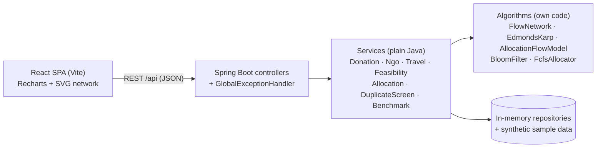

# SecondServe: An Algorithm-Driven Food Rescue and Surplus Meal Allocation System
**Technical Report — CIA 3, Advanced Algorithm (Semester V, B.Tech CS AI & ML, ATLAS – uGDX 2026-27)**
Team: *[Student name(s) and ID(s)]*

## Abstract
Surplus prepared meals from restaurants, hotels and canteens remain distributable only for a short window, while recipient NGOs differ in demand, pickup capacity and travel tolerance. SecondServe is a web application whose core is an allocation engine: the problem is modelled as a capacitated flow network and solved with an **Edmonds-Karp maximum flow** implementation written from scratch in Java, with a minimum cut identifying the capacity bottleneck. A from-scratch **Bloom filter** screens incoming donation-batch IDs for duplicates, always followed by an exact check (CO5). On the bundled data set the engine places 630 meal packs against 570 for a first-come-first-served (FCFS) greedy baseline. Across seeded benchmark instances Edmonds-Karp matched or exceeded FCFS (up to +11.7 % at 25×25) while taking longer per run, and the Bloom filter reached its 1 % target false-positive rate with zero false negatives using ~80× less memory than an exact hash set. 36 automated tests pass.

## 1. Introduction
Food rescue is a coordination problem. Donors know what they have and for how long it can be delivered; NGOs know what they can absorb; the link between them is travel time. This project builds a usable decision tool in which the algorithm is the product, not a decoration: removing Edmonds-Karp leaves nothing to compute, and removing the Bloom filter removes the duplicate-submission safeguard.

## 2. Real-world problem and operational limitations
Manual coordination (phone calls, group chats) suffers from: (1) **greedy order effects** — the first donor claims the NGO that only a later donor could reach; (2) **hidden constraints** — travel time and expiry are checked ad hoc; (3) **duplicate submissions** when several staff register the same batch; (4) **no explanation** of why food went unplaced; (5) **no bottleneck visibility** — coordinators cannot see whether more supply, more NGO capacity or more routes would help.

## 3. Proposed solution
For a planning time, compute the largest feasible redistribution, the per-pair quantities, the unallocated remainder with reasons, the bottleneck, and compare against the FCFS baseline. Scope: one food category (prepared meal packs), one planning window, manually entered travel times, synthetic data, no external services.

## 4. Requirements and assumptions
- Java backend (Spring Boot); JavaScript frontend (React); assessed algorithms implemented by us.
- Meal packs are indivisible → **integer** capacities and integral flows.
- Travel times are manual estimates; the “latest safe delivery time” is an **operational value entered by the user**. The system makes no food-safety claim.
- An NGO’s intake in one window is min(required meals, pickup capacity).
- Batches are assumed to depart at max(planning time, availability time).
- Maximum flow maximises *total meals placed*. It does **not** guarantee fairness between NGOs, freshness priority, or optimal vehicle routing.

## 5. System architecture

The controllers are thin; services and algorithms are framework-free, so they are unit-tested without a Spring context. The frontend holds no algorithmic logic and no precomputed values.

**Package layout:** `algorithm` (FlowNetwork, EdmondsKarp, AllocationFlowModel, FcfsAllocator, BloomFilter), `service` (business logic), `repository`, `model`, `dto`, `web` (controllers, error mapping), `exception`, `util` (validation, JSON), `benchmark`.

## 6. Data model
| Entity | Fields |
|---|---|
| Donation | batchId (unique, normalised upper-case), donorName, meals (int ≥ 1), availableFrom, safeUntil (> availableFrom), notes |
| Ngo | ngoId (unique), name, requiredMeals, pickupCapacity, maxTravelMinutes (1–1440), contact |
| Travel entry | (batchId, ngoId) → minutes (1–1440); absent = no estimate |
| AllocationResult | summary, rows, per-batch and per-NGO outcomes, bottleneck (min-cut edges), graph, baseline, stale flag |

Inputs are validated field by field (all errors reported at once); duplicate IDs → 409; unknown IDs → 404; malformed JSON → 400.

## 7. API design
`GET /api/dashboard`; `GET/POST /api/donations`, `PUT/DELETE /api/donations/{id}`, `POST /api/donations/import-csv`; `GET/POST /api/ngos`, `PUT/DELETE /api/ngos/{id}`; `GET/PUT /api/travel`; `GET /api/feasibility`; `POST /api/allocation/run`; `GET /api/allocation/results`; `GET /api/algorithms/network-analysis`, `bloom-stats`; `POST /api/algorithms/bloom-check`, `bloom-demo`, `benchmarks`; `POST /api/data/reset`. Responses are DTO records; errors use `{status, error, message, details[]}`.

## 8. Flow-network modelling
Nodes: source *s*, one node per donation batch *Bᵢ*, one per NGO *Nⱼ*, sink *t*.
- *s → Bᵢ*, capacity = meals of batch *i* (0 if expired — expired batches are removed from supply).
- *Bᵢ → Nⱼ*, capacity ∞, **added only if feasible**: batch not expired at planning time; travel time entered; travel ≤ NGO limit; max(planning, availableFrom) + travel ≤ deadline; NGO intake > 0.
- *Nⱼ → t*, capacity = min(requiredⱼ, pickupⱼ).

Putting the real limits on the outer edges keeps the minimum cut interpretable: cut edges are either *supply used up* (*s→Bᵢ*) or *NGO intake limit reached* (*Nⱼ→t*). The flow on *Bᵢ→Nⱼ* is the quantity assigned.

## 9. Edmonds-Karp
**Pseudocode**
```
EDMONDS-KARP(G, s, t):                      // G stored as paired arcs a, a^1 (forward, reverse)
  flow ← 0
  loop:
    BFS from s over arcs with residual(a) > 0; record parentArc[v]
    if t not reached: break                  // visited set = source side S of a min cut
    b ← min residual(a) over the path s→t
    for each arc a on the path: residual(a) −= b; residual(a^1) += b
    flow ← flow + b
  cutEdges ← forward arcs (u,v), u ∈ S, v ∉ S, capacity > 0
  return flow, cutEdges
```
**Correctness.** (1) Pushing *b* along a path with all residuals ≥ *b* preserves capacity constraints; reverse arcs record cancellable flow, so conservation holds at every internal node. (2) At termination no s→t path exists in the residual graph. Let *S* be the nodes reachable from *s*. Every edge leaving *S* is saturated and every edge entering *S* carries zero flow, hence flow value = capacity(S, V∖S). Since every flow is ≤ every cut capacity, this flow is maximum and the cut is minimum (max-flow min-cut theorem). (3) Termination: BFS shortest paths ⇒ each augmentation saturates a critical edge, an edge can be critical at most V/2 times ⇒ O(V·E) augmentations; with integer capacities flow values are integral. The implementation asserts nothing implicitly — tests EK-9 check conservation, capacity limits and flow = cut capacity on 200 random graphs.

**Complexity.** Time O(V·E²) (O(E) BFS × O(V·E) augmentations). Space O(V+E): arrays for 2E arcs, parent array, queue. For the bundled data V = 19, E = 32, 10 augmentations, 11 BFS passes.

**Reverse-edge rerouting in the sample run.** Augmentation 10 follows *Source → BATCH-102 → N-01 → (reverse) BATCH-101 → N-02 → Sink*: BATCH-102 can only reach N-01, so 60 meals that BATCH-101 had sent to N-01 are redirected to N-02. A greedy allocator cannot do this.

## 10. Bloom filter and duplicate screening
**Implementation.** `long[]` bit array; m = ⌈−n ln p /(ln 2)²⌉, k = round((m/n) ln 2); with n = 1000, p = 1 %: m = 9,586 bits (1,200 bytes), k = 7. Indices follow Kirsch–Mitzenmacher double hashing, *indexᵢ = (h₁ + i·h₂) mod m*, h₁ = SplitMix64(FNV-1a-64(key)), h₂ = SplitMix64(h₁ ⊕ φ) | 1. Operations: `put`, `mightContain`, expected false-positive rate (1 − e^(−kn/m))ᵏ, fill-based rate (set bits/m)ᵏ, memory in bytes, bit positions per key.

**Probability.** After *n* insertions a given bit is still 0 with probability (1 − 1/m)^(kn) ≈ e^(−kn/m); a never-inserted key is a false positive if all *k* probed bits are 1: ≈ (1 − e^(−kn/m))ᵏ, minimised at k = (m/n) ln 2 giving 2^(−k). There are no false negatives because bits are never cleared.

**Workflow (`DuplicateScreen`).** For a submitted ID: (1) `mightContain` false → *definitely new*, accept, no exact lookup. (2) true → query the authoritative repository: exists → **reject as duplicate (409)**; absent → **accept and count a false positive**. A Bloom hit alone never rejects. Because Bloom filters cannot delete, deleting a donation rebuilds the filter from the repository. The UI and API expose bit array, hash count, probe positions, screening log, exact-lookup count and observed false positives; an isolated sandbox lets a user shrink the filter and watch the false-positive rate climb.

## 11. Baseline comparison
FCFS processes batches in registration order and, for each, eligible NGOs in registration order, giving each min(remaining supply, remaining NGO capacity). It uses the *same* feasibility matrix and capacities. It is O(B·N) but never reconsiders. Counter-example (test EK-10): supply {10,10}, NGO capacity {10,10}, batch 0 can reach N0 and N1, batch 1 only N0. FCFS sends batch 0 to N0 → 10 meals; max flow sends batch 0 → N1 and batch 1 → N0 → 20 meals. Edmonds-Karp is **optimal for the constructed network** and so never worse than FCFS (property test AL-10, 150 random instances); this is a statement about total meals, not about speed.

## 12. Complexity summary
| Component | Time | Space |
|---|---|---|
| Edmonds-Karp | O(V·E²) worst case | O(V+E) |
| FCFS baseline | O(B·N) | O(B·N) output |
| Feasibility matrix | O(B·N) | O(B·N) |
| Bloom insert / query | O(k) | m bits (≈1.44·n·log₂(1/p) bits) |

## 13. Correctness tests (66, all passing; 36 original + 30 for the multi-role version)
Full list with expected results in `docs/test-report.md` (raw output in `docs/test-output.txt`).
- **Edmonds-Karp (10):** CLRS graph = 23 with cut 23; multiple augmenting paths; disconnected sink; zero-capacity edges; reverse-edge rerouting is *required and used*; invalid capacities/self-loops/bad terminals/1-node graph; boundary 2-node graphs; parallel edges; 200-graph stress with conservation + certificate; greedy-trap (20 vs 10).
- **Bloom filter (8):** inserted ID found (+5,000 no false negatives); never-inserted ID absent; possible duplicate verified exactly; **simulated false positive is not rejected**; empty/boundary/invalid configurations; repeated insertion idempotent; sizing m = 9,586, k = 7; observed rate ≈ 1 %.
- **Feasibility (7)** and **service/end-to-end (11):** expiry, missing travel time, NGO limit boundary (30 ok / 31 rejected), deadline boundary, availability-delayed departure, empty dataset errors, duplicate rejection, delete-then-reuse ID, CSV import, stale results, JSON round trip.

## 14. Benchmark methodology and measured results
Executed by `scripts/benchmark.*` (class `BenchmarkMain`) on 2026-11-18, Java 21.0.13, **1 CPU** sandbox, seed 2026 (instance seed = 2026 + size), median of 15 timed runs after warm-up, `System.nanoTime`. Flow instances: supply 20–120, NGO capacity 30–130, each route feasible with probability 0.25. Both allocations are validated against all constraints. Raw files: `docs/benchmark-results.{json,csv,md}`.

**Edmonds-Karp vs FCFS**
| Donors×NGOs | Feasible routes | Supply | EK meals | FCFS meals | Gap | EK ms | FCFS ms | Augment. |
|---|---|---|---|---|---|---|---|---|
| 10×10 | 26 | 672 | 620 | 620 | 0 (0 %) | 0.0112 | 0.0027 | 12 |
| 25×25 | 155 | 1766 | 1766 | 1581 | +185 (11.7 %) | 0.1912 | 0.0141 | 51 |
| 50×50 | 651 | 3320 | 3320 | 3267 | +53 (1.6 %) | 0.8230 | 0.0482 | 88 |
| 100×100 | 2463 | 7023 | 7023 | 7023 | 0 (0 %) | 2.1780 | 0.0484 | 184 |

**Bloom filter vs exact HashSet** (n inserted IDs, 20,000 never-inserted queries each)
| n | m bits | k | Bloom bytes | HashSet bytes (est.) | False positives | Observed | Theory | False neg. | Bloom ms | HashSet ms |
|---|---|---|---|---|---|---|---|---|---|---|
| 100 | 959 | 7 | 120 | 9,904 | 197 | 0.99 % | 1.00 % | 0 | 2.60 | 0.227 |
| 1,000 | 9,586 | 7 | 1,200 | 96,272 | 204 | 1.02 % | 1.00 % | 0 | 3.04 | 0.264 |
| 10,000 | 95,851 | 7 | 11,984 | 945,616 | 199 | 1.00 % | 1.00 % | 0 | 3.13 | 0.449 |

**Interpretation (honest).**
1. Edmonds-Karp never allocated fewer meals than FCFS, and was strictly better at 25×25 (+185) and 50×50 (+53). At 10×10 and 100×100 greedy happened to reach the same total: with sparse tiny instances there is little interference, and with dense large instances capacity is plentiful so early choices rarely block anything. The benefit appears when constrained NGOs are reachable by only some batches.
2. Edmonds-Karp is **slower** than FCFS (roughly 4–45× here), consistent with O(V·E²) versus O(B·N); the extra time buys optimality and the min-cut explanation. Both are far below human-scale latency.
3. The Bloom filter hit its target false-positive rate (≈1 %), had no false negatives, and needed ≈80× less memory than an exact set. In-memory it is **not faster** than a HashSet (it computes 7 hashes per query); its value in this application is skipping ≈99 % of exact-lookups (19,796–19,803 of 20,000 negatives) when the authoritative store is slower than RAM (a database).
4. Timings on a 1-CPU shared sandbox are noisy: an earlier run of the same code measured 6.17 ms for 100×100 Edmonds-Karp versus 2.18 ms above, while meals and false-positive counts were identical. Quote ratios and trends, not absolute times, and re-run on your machine.

## 14b. Extension: multi-role platform and four additional algorithms
The original system maximised the number of meals but, as Section 15 admits, did not address fairness, freshness priority or route cost, and had a single anonymous user. The extension (full description in [new-features.md](new-features.md)) adds:

* **Min-cost maximum flow** (successive shortest paths, SPFA, O(F·V·E)) on the same network with per-edge costs (travel + safety-margin penalty, and a minutes-to-deadline cost on supply). It places exactly as many meals as Edmonds-Karp but minimises cost; measured travel reduction 4.8%–65.2% on 10×10…100×100 seeded instances.
* **Max-min fair allocation** by progressive filling (binary search on the common level + greedy single-step raise for integer ties, each feasibility test a max-flow). Because receipt vectors form a polymatroid, fairness costs zero meals; the smallest NGO share rose from 0 to 31–38 meals in every benchmark.
* **Interval partitioning** with a min-heap: the minimum number of volunteers equals the maximum number of simultaneous trips (depth), so the greedy schedule is optimal. Benchmark honestly shows a linear first-fit scan is faster at these fleet sizes.
* **Count-Min Sketch** with streaming heavy hitters for impact analytics: never under-estimates, error ≤ ε·N with probability ≥ 1−δ, fixed 108,760 bytes versus ≈5.2 MB for an exact map at 1,000,000 events (but larger than the map at 10,000 events).
* **Three role-based dashboards**, authentication (PBKDF2, bearer tokens, lockout), one `AccessPolicy` shared by all servers, record-level ownership, a delivery life cycle with notifications and audit log, and exact what-if sensitivity analysis.

Verification: 66 JUnit tests (Section 13 plus 30 new). The min-cost and fair allocators are compared with exhaustive enumeration of all integer allocations on hundreds of random instances. During development this found a genuine flaw in the first fair-allocation design (it assumed some NGO is always individually frozen at the maximal common level, which is false for integer ties); the greedy single-step raise replaced it.

## 15. Limitations
- Max flow does not enforce fairness, priority for earlier deadlines, or minimum service per NGO; the result is one of possibly many maximum flows. The reported min cut is the one nearest the source found by the final BFS; other minimum cuts of equal capacity may exist.
- Single food category, single window; travel times are manual; no vehicle routing or split-trip modelling.
- In-memory storage: data are lost on restart (sample data reloads).
- The Bloom filter is rebuilt on delete (O(n)); a counting Bloom filter would avoid that.
- Benchmarks measure synthetic instances on one machine; the HashSet memory figure is an estimate.
- Authentication, concurrency control beyond simple synchronisation, and multi-user roles are out of scope.

## 16. Future improvements
Priority/fairness via min-cost max-flow or weighted rounds; time-expanded networks for multiple pickup windows; counting Bloom filter; persistent database; metric-TSP-based pickup routing (Unit 5) layered on the assigned flows; role-based access.

## 17. Individual contributions
| Student | ID | Contribution (components, files, tests) |
|---|---|---|
| *[Name 1]* | *[ID]* | *[e.g., Edmonds-Karp, flow model, allocation service, EK tests]* |
| *[Name 2]* | *[ID]* | *[e.g., Bloom filter, duplicate screening, benchmarks, BF tests]* |
| *[Name 3]* | *[ID]* | *[e.g., React frontend, API integration, documentation]* |

*Fill in from the Git history; every member must be able to explain their algorithm, correctness and complexity in the viva.*
